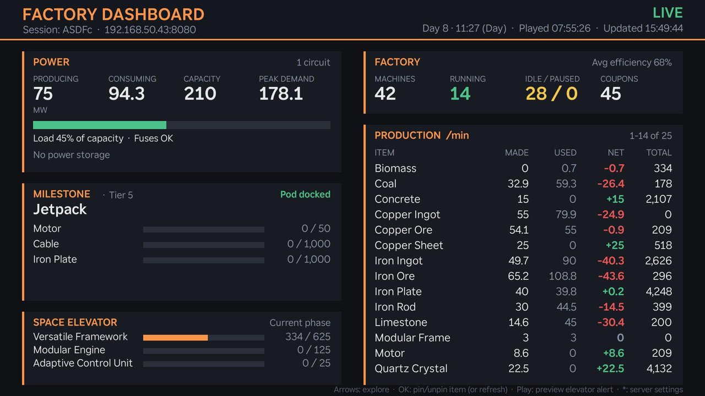
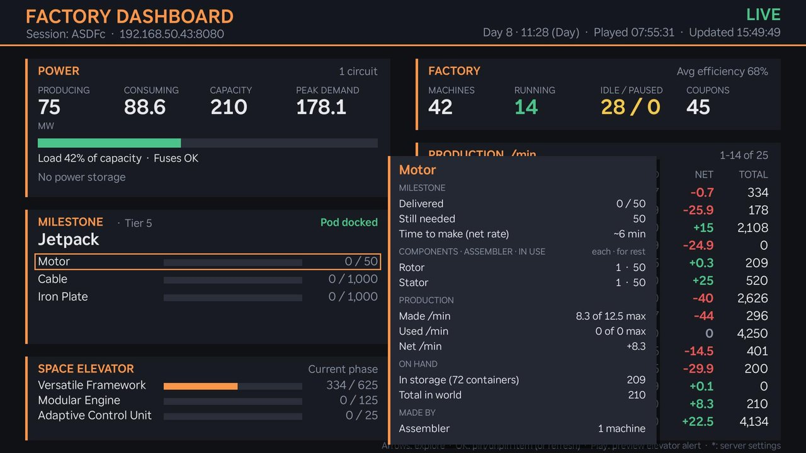
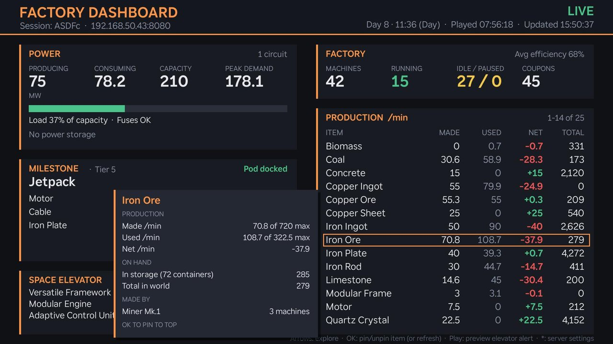
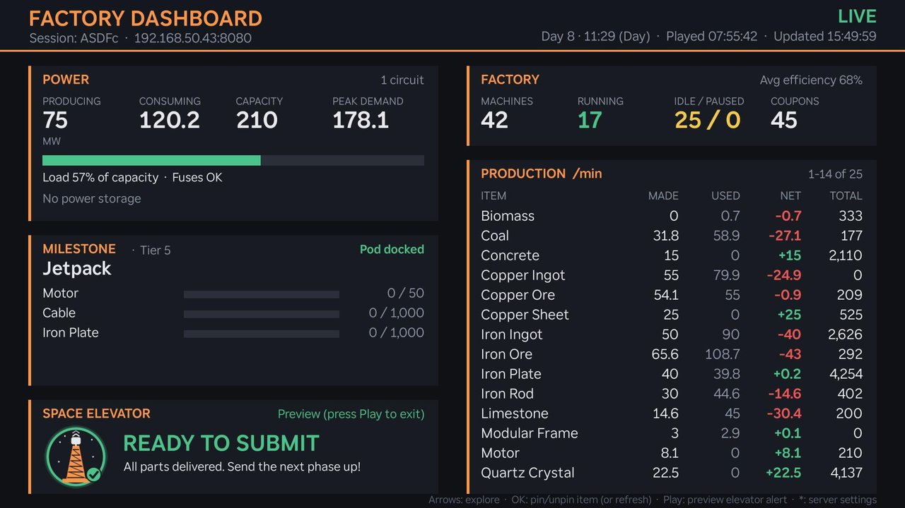
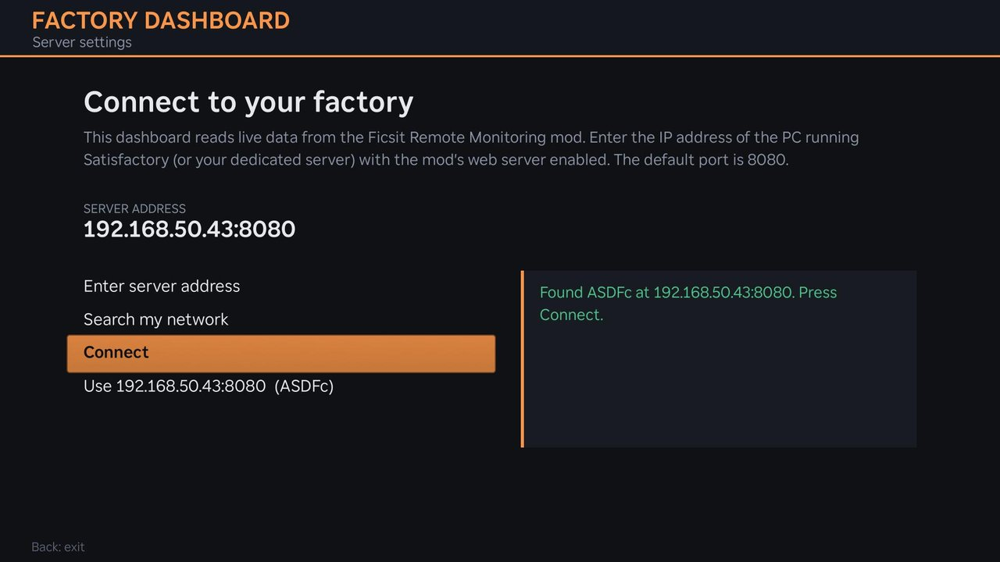

# FRM Roku Dashboard

[](https://paypal.me/ronaldroe)

A Roku TV app that shows a live dashboard of your Satisfactory factory: power, milestones,
the Space Elevator, machines and production. It reads the data served by the
[Ficsit Remote Monitoring](https://ficsit.app/mod/FicsitRemoteMonitoring) mod.



This is a fan-made project. It is not affiliated with or endorsed by Coffee Stain
Studios or the authors of Ficsit Remote Monitoring.

## Features

- **Power:** production, consumption, capacity and peak demand, a load bar that
  turns yellow and then red as you approach capacity, fuse and battery status.
- **Milestone:** the active HUB milestone with per-part progress bars, plus pod status
  ("Pod docked", or a countdown while it's away).
- **Space Elevator:** progress on the current phase. When every part is delivered, the
  bars are replaced by a "Ready to submit" banner and a chime plays.
- **Factory:** machines running, idle and paused, average efficiency, and coupons.
- **Production:** every item being made or used, in alphabetical order, with made, used
  and net per minute and the total you have. Pin up to 5 items to the top, and
  optionally have the parts for your current milestone and Space Elevator phase
  pinned automatically.
- **Tooltips:** move around with the arrow keys to see more detail on anything,
  including the components a part needs, rough time to finish, where items are made,
  power use by machine type, and why idle machines are idle.

| Milestone part tooltip | Production item tooltip |
| --- | --- |
|  |  |

| Space Elevator ready | Server setup |
| --- | --- |
|  |  |

## What you need

- A Roku device (Roku TV, stick or box) and its remote.
- A PC running Satisfactory, or a Satisfactory dedicated server.
- The [Ficsit Remote Monitoring](https://ficsit.app/mod/FicsitRemoteMonitoring) mod,
  installed with Satisfactory Mod Manager (Step 1 below).
- The Roku and the game PC (or server) on the same home network.

Setup takes four steps: install the mod, turn on its web server, put the Roku in
developer mode, and install the app.

## Step 1: Install the mod with Satisfactory Mod Manager

1. Download and install **Satisfactory Mod Manager (SMM)** from
   [ficsit.app](https://ficsit.app). Satisfactory must be closed while SMM installs mods.
2. Open SMM. It finds your Satisfactory installation automatically. If you have more
   than one, choose the one you play from the install list at the top.
3. In SMM's mod list, search for **Ficsit Remote Monitoring** and click **Install**.
   SMM also installs the Satisfactory Mod Loader (SML), which the mod needs.
4. Make sure mods are turned on in SMM, then launch the game. You can launch it from
   SMM or from Steam or Epic as usual.

**Playing on a dedicated server?** The mod goes on the server, not your PC. SMM can
install mods on a dedicated server: add the server in SMM's install list, then install
Ficsit Remote Monitoring there. Players who connect only need the mod loader, which
SMM installs for them when they join with mods enabled.

## Step 2: Turn on the mod's web server

The mod's web server is **off by default**, so you need to turn it on.

### Single player, or hosting a game

1. Load your save.
2. Press **Esc** to open the pause menu.
3. Choose **Options**, then **Ficsit Remote Monitoring**. The mod has its own entry
   in the Options menu.
4. Turn on the web server's **auto-start** setting so it starts every time you load a
   save. Leave the port at **8080** unless something else on your PC already uses it.
5. Apply the change, then save and reload so the web server starts. Alternatively,
   start it immediately by opening chat (**Enter**) and typing:
   ```
   /frm http start
   ```

### Dedicated server

On the server, edit `GameUserSettings.ini`:

- Windows: `<server folder>/FactoryGame/Saved/Config/WindowsServer/GameUserSettings.ini`
- Linux: `<server folder>/FactoryGame/Saved/Config/LinuxServer/GameUserSettings.ini`

Set `FicsitRemoteMonitoring.Server.uWS.Autostart` to on and, optionally, change
`FicsitRemoteMonitoring.Server.uWS.Port` (default 8080). Then restart the server.

### Check that it works

1. Find the game PC's IP address. On Windows, open Command Prompt, run `ipconfig`, and
   look for **IPv4 Address** (something like `192.168.1.20`).
2. On another device on the same network, such as your phone, open
   `http://<that IP>:8080` in a browser. You should see the mod's web page.
3. If it loads on the game PC but not on your phone, Windows Firewall is probably
   blocking it. Open **Windows Defender Firewall → Allow an app through firewall** and
   allow Satisfactory (`FactoryGame`) on **Private** networks. Windows may also ask the
   first time the web server starts; choose **Allow** for private networks.

## Step 3: Put your Roku in developer mode

Developer mode lets you install apps that aren't from the Roku Channel Store. It's
free, and you can turn it off again at any time.

1. Turn on the TV and go to the Roku home screen.
2. On the remote, press this sequence quickly:
   **Home, Home, Home, Up, Up, Right, Left, Right, Left, Right**
3. The Developer Settings screen opens. Write down the **IP address** it shows
   (for example `http://192.168.1.50`). That's the Roku's address.
4. Choose **Enable installer and restart**, then accept the developer agreement.
5. Create a **web server password**. You'll use it to upload the app, so write it down.
   The username is always `rokudev`.
6. The Roku restarts. Developer mode is now on.

If you lose the Roku's IP address, it's also under **Settings → Network → About**.

## Step 4: Install the app

1. Download **`frm-roku-dashboard.zip`** from the
   [Releases page](https://github.com/ronaldroe/frm-roku-dashboard/releases).
   Don't unzip it.
2. On a computer on the same network, open the Roku's IP address from Step 3 in a
   browser, such as `http://192.168.1.50`.
3. Sign in with username `rokudev` and the password you created.
4. Click **Upload**, choose the zip file, then click **Install with zip**.
5. The app launches on your TV right away. Afterwards, it's on your home screen as
   **Factory Dashboard**.

To update to a newer version, repeat these steps with the new zip.

### First launch

The app asks which server to use:

1. Choose **Search my network**. The app scans your network for the mod, which takes
   about 15 seconds, and fills in the address it finds.
2. If it doesn't find it, choose **Enter server address** and type the game PC's IP
   from Step 2. Add `:port` only if you changed it from 8080.
3. Choose **Connect**. The app tests the connection, then opens the dashboard.

The app remembers the address. To change it later, press `*` on the remote and
choose **Server**.

## Using the app

| Button | Action |
| --- | --- |
| Arrows | Move the highlight and show tooltips |
| OK | Pin or unpin the highlighted production item (elsewhere: refresh now) |
| Play/Pause | Preview the Space Elevator "ready" alert |
| `*` (Options) | Settings |
| Back | Hide the highlight; press again to exit |

The highlight hides itself after 30 seconds without a key press.

### Settings

Press `*` to open the settings. Use the arrows to choose an option and OK to change it.

| Setting | What it does |
| --- | --- |
| Server | Change the game PC's address, or search your network for it. |
| Auto-pin milestone parts | Pins the parts of the milestone you're working on to the top of the production list. Off by default. |
| Auto-pin Space Elevator parts | Pins the parts of the current Space Elevator phase to the top of the production list. Off by default. |

Auto-pinned items appear after the items you pinned yourself and have a blue marker
instead of an orange one. They change on their own when you pick a new milestone or
the elevator moves to its next phase. An item that is both pinned by you and needed
for a milestone or phase is listed once. Auto-pins don't count toward your 5 pins, but
at most 10 rows are pinned in total so the rest of the list still scrolls.

**Keeping it on screen:** Roku's screensaver can start while the dashboard is up. To
stop that, go to **Settings → Theme → Screensaver** on the Roku and set the wait time
to **Disabled**, or to a longer time.

## Troubleshooting

When it can't connect, the app tells you why:

- **No response:** the IP is wrong, the PC is off or asleep, or a firewall is blocking
  the port. See "Check that it works" in Step 2.
- **Nothing listening on that port:** the PC is reachable, but the game isn't running
  or the mod's web server hasn't started. Load your save, or type `/frm http start` in
  chat.
- **Isn't Ficsit Remote Monitoring:** something else is using that port. Check the port
  in the mod's settings.

If the dashboard loses the connection while you're playing, it shows the reason and
keeps retrying, so it reconnects by itself when the game comes back.

**The IP keeps changing:** most routers can reserve a fixed IP for a device. Look for
"DHCP reservation" or "static lease" in your router's settings and reserve one for the
game PC.

## For developers

### Building and deploying

```sh
cp .env.example .env   # set your Roku's IP and dev password
./deploy.sh            # zips roku-frm/ and sideloads it to the Roku
```

To build the zip by hand, zip the contents of `roku-frm/`, not the folder itself:

```sh
cd roku-frm && zip -r ../frm-roku-dashboard.zip manifest source components images sounds
```

The Roku's debug console (`telnet <roku-ip> 8085`) shows logs and compile errors.

### Publishing a release

```sh
./release.sh --dry-run 1.1.0   # check what would happen
./release.sh 1.1.0             # notes generated from commits
./release.sh 1.1.0 notes.md    # or notes from a file
```

The script refuses to run unless `main` is clean and pushed. It sets the version in
the manifest, commits, tags, pushes, builds `frm-roku-dashboard.zip` and creates the
GitHub release with it attached. It asks before changing anything.

### Project layout

```
roku-frm/
  manifest                    App metadata, optional default server, refresh interval
  source/main.brs             Entry point
  components/MainScene.*      Layout, rendering, navigation, tooltips, pins
  components/FetchTask.*      Background polling of the mod's API and data summaries
  components/SettingsScreen.* Settings menu (server, auto-pin options)
  components/SetupScreen.*    Server address entry, network search, connection test
  components/ProbeTask.*      Connection test and local network scan
  components/Common.brs       Shared helpers (HTTP, error messages, saved settings)
  images/, sounds/            Icons, splash, elevator badge, chime
deploy.sh                     Package and sideload to the Roku in .env
release.sh                    Version, tag and publish a GitHub release
```

### Notes

- Fast-changing data (power, production, HUB, Space Elevator) refreshes every 5 seconds,
  heavier data every 20 seconds, and the recipe list every 10 minutes.
- Some versions of the mod always report the pod's return countdown as `00:00:00`.
  When that happens, the app times the pod's trip itself and uses the last trip at the
  same tier to estimate the next one.
- The server address, settings, pinned items and pod trip times are saved on the
  Roku and survive restarts.

## Support the project

If the dashboard is useful to you, you can buy me a coffee through
[PayPal](https://paypal.me/ronaldroe). Thank you!
