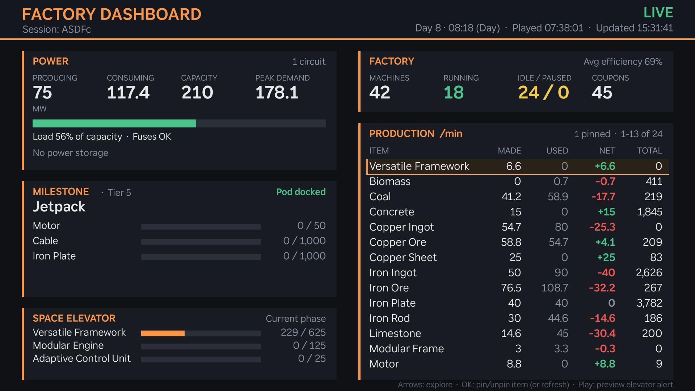

# Factory Dashboard for Roku

A Roku TV app that shows a live dashboard of your Satisfactory factory, using the
data served by the [Ficsit Remote Monitoring](https://ficsit.app/mod/FicsitRemoteMonitoring)
mod.



This is a fan-made project. It is not affiliated with or endorsed by Coffee Stain
Studios or the authors of Ficsit Remote Monitoring.

## Features

- **Power:** production, consumption, capacity and peak demand, a load bar that
  turns yellow and then red as you approach capacity, fuse and battery status.
- **Milestone:** the active HUB milestone with per-part progress bars, plus pod status.
- **Space Elevator:** progress on the current phase. When every part is delivered, the
  bars are replaced by a "Ready to submit" banner and a chime plays.
- **Factory:** machines running, idle and paused, average efficiency, and coupons.
- **Production:** every item being made or used, in alphabetical order, with made, used
  and net per minute and the total you have. Pin up to 5 items to the top.
- **Tooltips:** move around with the arrow keys to see more detail on anything,
  including recipes, the components still needed, rough time to finish, where items
  are made, power use by machine type, and why idle machines are idle.

## Remote controls

| Button | Action |
| --- | --- |
| Arrows | Move the highlight and show tooltips |
| OK | Pin or unpin the highlighted production item (elsewhere: refresh now) |
| Play/Pause | Preview the Space Elevator "ready" alert |
| Back | Hide the highlight; press again to exit |

The highlight hides itself after 30 seconds without a key press.

## Requirements

- A Roku device with [developer mode](https://developer.roku.com/docs/developer-program/getting-started/developer-setup.md)
  enabled (on the remote, press Home ×3, Up ×2, Right, Left, Right, Left, Right).
- Satisfactory with the **Ficsit Remote Monitoring** mod installed and its web server
  running (port 8080 by default). Opening `http://<game-pc-ip>:8080` in a browser
  should show the mod's web page.
- The Roku and the computer running the game (or the dedicated server) on the same
  network, with port 8080 reachable through any firewall.

## Install (sideload)

1. Point the app at your server by editing `frm_url` in `roku-frm/manifest`.
2. Zip the contents of `roku-frm/` (not the folder itself):
   ```sh
   cd roku-frm && zip -r ../roku-frm.zip manifest source components images sounds
   ```
3. Open `http://<roku-ip>` in a browser, log in as `rokudev` with your dev-mode
   password, upload the zip and click **Install**.

Or use the deploy script, which zips and uploads in one step:

```sh
cp .env.example .env   # then set your Roku's IP and dev password
./deploy.sh
```

## Project layout

```
roku-frm/
  manifest                 App metadata, server URL, refresh interval
  source/main.brs          Entry point
  components/MainScene.*   Layout, rendering, navigation, tooltips, pins
  components/FetchTask.*   Background polling of the mod's API and data summaries
  images/, sounds/         Icons, splash, elevator badge, chime
deploy.sh                  Package and sideload to the Roku in .env
```

## Notes

- Fast-changing data (power, production, HUB, Space Elevator) refreshes every 5 seconds,
  heavier data every 20 seconds, and the recipe list every 10 minutes.
- Some versions of the mod always report the pod's return countdown as `00:00:00`.
  When that happens, the app times the pod's trip itself and uses the last trip at the
  same tier to estimate the next one.
- Pinned items and pod trip times are saved on the Roku and survive restarts.
